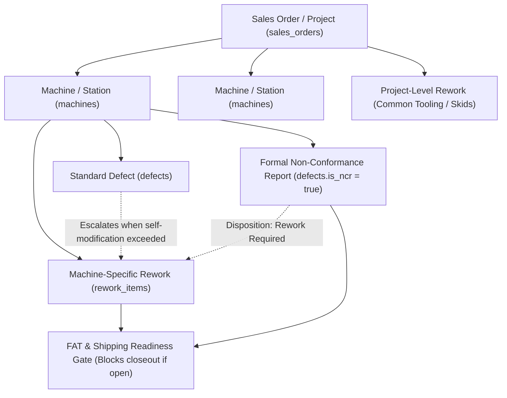

# Rework Procedure & SOP 1-003 Tracking Guide

## 1. Overview & Objective

This document outlines the architecture, data model, operational workflow, and API reference for the **Rework Tracking Module** in Flux, engineered in strict accordance with **VTR Feeder Solutions SOP 1-003 ("Standard Operating Procedure for Rework")**.

Prior to this implementation, rework and service parts were tracked via manual red-ink drawing stamps and a disconnected Excel spreadsheet on SharePoint (*"VTR Rework/Service Part Tracking"*). The Flux Rework Module replaces these disparate systems with a unified, real-time, project-contained operational hub that connects Design, Project Management, Manufacturing, Kitting/Receiving, Assembly, and Electrical/Controls.

---

## 2. Project Containment & Entity Relationships

Rework does not exist in isolation; it is directly contained within the overarching project scope alongside tactical defects and formal Non-Conformance Reports (NCRs).



### Relational Hierarchy:
1. **Sales Order (`sales_orders`)**: The parent commercial project (e.g., Project 1024). Every rework item requires a valid `sales_order_id`.
2. **Machine (`machines`)**: The specific station or unit (e.g., Centrifugal Bowl 1024A). Can be `NULL` for project-wide rework (e.g., shared machine bases, skids, or tooling).
3. **Defect / NCR (`defects`)**: Optional foreign key `defect_id`.
   - **Tactical Defect Escalation**: When an Assembler cannot self-modify a part on the shop floor, the defect is escalated to an engineering rework item.
   - **NCR Disposition**: When a formal NCR results in a disposition of "Rework" or "Scrap & Remake", a rework traveler is spawned.
4. **FAT & Ship Readiness**: A machine cannot be certified as ready for Factory Acceptance Testing (FAT) or customer shipment while incomplete rework items or open NCRs remain against it.

---

## 3. Departmental Workflows (SOP 1-003 Lifecycle)

```mermaid
stateDiagram-v2
    direction TD

    state "1. Design Department" as S1 {
        [*] --> DesignDraft: ECO / Defect Escalation / NCR Disposition
        DesignDraft: Update SolidWorks CAD & Drawings
        DesignDraft: Increment REV & Describe in Rev Table
        DesignDraft: Digital Red REWORK Stamp
        DesignDraft: Mark PDM Vault Released
    }

    state "2. Project Management Review" as S2 {
        DesignDraft --> ReleasedToPM: Handed to PM / Plant Mgr
        ReleasedToPM: Negotiate Timeline (Mfg + PP)
        ReleasedToPM: Collect MOD Parts from Assembly
        ReleasedToPM: Release to Manufacturing
    }

    state "3. Manufacturing Execution" as S3 {
        ReleasedToPM --> InMachining: Assigned to Machinist
        InMachining: Order Raw Material (if required)
        InMachining: Execute Machining / CNC / Fabrication
        InMachining: Record Date Completed & Part Location
        InMachining --> AfterHours: After-hours parts desk drop
    }

    state "4. Outside Processing" as S4 {
        InMachining --> OutsideProcessing: Anodize / Heat Treat / Black Oxide / Plating
        OutsideProcessing: Kitting logs vendor, sent date & expected return
        OutsideProcessing: Kitting logs received date & delivers to PM
    }

    state "5. Delivery & Re-assembly" as S5 {
        InMachining --> DeliveredToAssembly: Internal machining only
        OutsideProcessing --> DeliveredToAssembly: Returned from outside
        DeliveredToAssembly: Delivered to Assembler
        DeliveredToAssembly: Part re-installed on machine
    }

    state "6. Complete Archive" as S6 {
        DeliveredToAssembly --> Complete: Verified & Archived
        Complete: Linked Defect auto-resolved
        Complete: FAT gate unblocked
    }
```

### 1. Mechanical Design
- Modifies SolidWorks models and drawings.
- Increments drawing revision and describes changes in the drawing revision table.
- Applies the digital red **REWORK** stamp with:
  - Project Number & Letter (e.g. `1024A`).
  - Total Quantity Required.
  - Part Disposition: **NEW** (made from scratch) vs. **MOD** (modifying existing physical component).
- Checks files into SolidWorks PDM vault in the `Released` state.
- Formally releases drawing to the Project Manager (or Plant Manager in their absence).

### 2. Assembly Department
- Assemblers determine whether rework can be performed directly at the bench. If self-modifiable, no rework order is generated (drawing is redlined locally).
- If self-modification is impossible, the assembler coordinates with Design and pulls physical parts that need modification (**MOD**), delivering them to the Project Manager.
- Re-receives completed components from the PM upon delivery.

### 3. Project Management
- Receives rework traveler from Design and physical parts from Assembly (if **MOD**).
- Negotiates priority and completion timeline with Manufacturing:
  - `requested_completion_date`: Target date combining manufacturing and outside processing (`Mfg + PP`).
- Logs reason for rework and releases drawing and parts to the Manufacturing Lead.
- Delivers completed parts to Assembly or tracks outside processing through Kitting.

### 4. Manufacturing Lead & Machine Shop
- Receives traveler and parts.
- Sets `expected_completion_date`, logs `material_ordered_date` if raw stock is required, and assigns the work to a specific machinist.
- **After-Hours Drop Protocol**: When parts and drawings are delivered to the manufacturing desk after hours, an after-hours handoff is recorded (`POST /api/rework-items/{id}/after-hours-drop`), capturing timestamp and notifying leads.
- Records `date_mfg_completed` and notes where parts were left (`part_given_to_or_left_at`).

### 5. Kitting & Receiving (Outside Processing)
- Tracks external secondary operations (anodizing, heat treating, black oxide, passivation).
- Records:
  - `outside_processing_vendor`
  - `date_sent_for_processing`
  - `date_expected_from_processing`
  - `date_received_from_processing`
- Logs delivery back to the PM/Plant Manager upon receipt.

### 6. Electrical & Controls Schematics (SOP Section 6)
- Controls Group Lead maintains Master Electrical Schematics.
- When circuit or enclosure modifications occur, controls team members redline the master schematic.
- Prior to project completion, schematics are drafted to match master redlines and the team member signs off on the Electrical Design Checklist.
- Tracked via dedicated controls schematic endpoints and the `/rework` UI tab.

---

## 4. Database Schema

Migration: `000021_add_rework_sop_tracking`

### Custom Enums:
- `rework_part_type`: `'NEW'`, `'MOD'`
- `rework_status`:
  - `'design_draft'`
  - `'released_to_pm'`
  - `'released_to_mfg'`
  - `'in_machining'`
  - `'outside_processing'`
  - `'delivered_to_pm'`
  - `'delivered_to_assembly'`
  - `'complete'`
  - `'cancelled'`

### Primary Tables:
```sql
CREATE TABLE rework_items (
    id UUID PRIMARY KEY DEFAULT gen_random_uuid(),
    sales_order_id UUID NOT NULL REFERENCES sales_orders(id) ON DELETE CASCADE,
    machine_id UUID REFERENCES machines(id) ON DELETE CASCADE,
    defect_id UUID REFERENCES defects(id) ON DELETE SET NULL,

    -- Design
    project_number VARCHAR(50) NOT NULL,
    sub_assembly VARCHAR(100),
    part_number VARCHAR(100) NOT NULL,
    description TEXT NOT NULL,
    revision VARCHAR(20) NOT NULL,
    material VARCHAR(100) NOT NULL,
    qty INT NOT NULL DEFAULT 1,
    part_type rework_part_type NOT NULL DEFAULT 'NEW',
    mech_designer_id UUID REFERENCES users(id) ON DELETE SET NULL,
    date_released_from_mech_design TIMESTAMPTZ,
    pm_released_to_id UUID REFERENCES users(id) ON DELETE SET NULL,
    pdm_vault_released BOOLEAN NOT NULL DEFAULT FALSE,

    -- Project Management
    reason_for_rework TEXT NOT NULL,
    date_released_to_mfg TIMESTAMPTZ,
    requested_completion_date DATE,
    pm_delivered_to VARCHAR(100),
    pm_date_delivered TIMESTAMPTZ,

    -- Manufacturing
    expected_completion_date DATE,
    material_ordered_date DATE,
    assigned_machinist_id UUID REFERENCES users(id) ON DELETE SET NULL,
    date_mfg_completed TIMESTAMPTZ,
    part_given_to_or_left_at VARCHAR(100),

    -- Outside Processing (Kitting)
    requires_outside_processing BOOLEAN NOT NULL DEFAULT FALSE,
    outside_processing_vendor VARCHAR(100),
    date_sent_for_processing DATE,
    date_expected_from_processing DATE,
    date_received_from_processing DATE,
    kitting_delivered_to VARCHAR(100),
    kitting_date_delivered TIMESTAMPTZ,

    -- Lifecycle & After Hours
    status rework_status NOT NULL DEFAULT 'design_draft',
    after_hours_drop BOOLEAN NOT NULL DEFAULT FALSE,
    after_hours_drop_at TIMESTAMPTZ,
    after_hours_notes TEXT,
    created_at TIMESTAMPTZ NOT NULL DEFAULT NOW(),
    updated_at TIMESTAMPTZ NOT NULL DEFAULT NOW()
);

CREATE TABLE controls_schematic_reworks (
    id UUID PRIMARY KEY DEFAULT gen_random_uuid(),
    sales_order_id UUID NOT NULL REFERENCES sales_orders(id) ON DELETE CASCADE,
    machine_id UUID REFERENCES machines(id) ON DELETE CASCADE,
    schematic_number VARCHAR(100) NOT NULL,
    revision VARCHAR(20) NOT NULL DEFAULT 'A',
    description TEXT NOT NULL,
    master_redlined BOOLEAN NOT NULL DEFAULT FALSE,
    redlined_by_id UUID REFERENCES users(id) ON DELETE SET NULL,
    schematics_updated BOOLEAN NOT NULL DEFAULT FALSE,
    updated_by_id UUID REFERENCES users(id) ON DELETE SET NULL,
    design_checklist_signed_off BOOLEAN NOT NULL DEFAULT FALSE,
    checklist_signed_off_by_id UUID REFERENCES users(id) ON DELETE SET NULL,
    checklist_signed_off_at TIMESTAMPTZ,
    created_at TIMESTAMPTZ NOT NULL DEFAULT NOW(),
    updated_at TIMESTAMPTZ NOT NULL DEFAULT NOW()
);
```

---

## 5. API Reference

All endpoints adhere to unified JSON responses (`respondJSON` and `respondError`).

### Rework Items CRUD & Filters

#### `GET /api/rework-items`
Query filters:
- `sales_order_id` (UUID)
- `machine_id` (UUID)
- `defect_id` (UUID)
- `status` (`design_draft`, `in_machining`, `outside_processing`, `complete`, etc.)
- `stage` (`active`, `outside`, `completed`)
- `sub_assembly` (string substring match)

**Response `200 OK`**:
```json
[
  {
    "id": "c1f7b0a8-...",
    "sales_order_id": "a9d8...",
    "machine_id": "b7c2...",
    "project_number": "1024A",
    "sub_assembly": "Sub-Assy 01 - Escapement",
    "part_number": "1024-M-01",
    "description": "Escapement guide bracket modification",
    "revision": "B",
    "material": "6061-T6 Aluminum",
    "qty": 2,
    "part_type": "MOD",
    "pdm_vault_released": true,
    "reason_for_rework": "Clearance gap interference during bowl test",
    "status": "in_machining",
    "assigned_machinist_name": "Dave Smith",
    "after_hours_drop": false
  }
]
```

#### `POST /api/rework-items`
Create a new rework item. Automatically broadcasts SSE event `rework_created`.

#### `GET /api/rework-items/{id}`
Retrieve a single rework item with joined foreign entity metadata (sales order title, machine serial, user names).

#### `PUT /api/rework-items/{id}`
Update rework item fields and stage progression. Automatically broadcasts SSE event `rework_updated`.

#### `DELETE /api/rework-items/{id}`
Delete a rework item. Automatically broadcasts SSE event `rework_deleted`.

---

### Operations & Gates

#### `POST /api/rework-items/{id}/after-hours-drop`
Marks a physical component and drawing as dropped at the manufacturing desk outside normal operating hours.

**Payload**:
```json
{
  "notes": "Left drawing and 2x brackets in the inbox tray on the lead desk"
}
```

#### `GET /api/sales_orders/{id}/rework-summary`
Returns project-level rollups for management dashboards:
```json
{
  "sales_order_id": "a9d8...",
  "total_rework_items": 5,
  "active_rework_items": 2,
  "completed_rework_items": 3,
  "in_machining_count": 1,
  "outside_processing_count": 1,
  "new_parts_count": 3,
  "mod_parts_count": 2
}
```

#### `GET /api/machines/{id}/fat-readiness`
Evaluates whether a machine is clear of open NCRs and incomplete rework orders before authorizing Factory Acceptance Testing (FAT).

**Response `200 OK`**:
```json
{
  "machine_id": "b7c2...",
  "ready_for_fat": false,
  "open_defects_count": 3,
  "open_ncrs_count": 1,
  "active_reworks_count": 1,
  "blocking_reasons": [
    "Machine has 1 active rework item(s) pending completion",
    "Machine has 1 unresolved NCR(s)"
  ]
}
```

---

### Controls & Master Schematics

#### `GET /api/controls-schematics`
Supports filtering by `sales_order_id` or `machine_id`.

#### `POST /api/controls-schematics`
Registers an electrical schematic revision for tracking redlines and checklist verification.

#### `PUT /api/controls-schematics/{id}`
Updates redline and sign-off status. When `design_checklist_signed_off` is set to `true`, `checklist_signed_off_at` is automatically stamped.

---

## 6. Frontend Hub & User Interface

The Rework Module is accessible via the global navigation at `/rework`:

1. **Header Action & Metrics Summary**:
   - `+ LOG REWORK` modal launcher.
   - Live KPI cards: Active Reworks, In Machining, Outside Processing, Completed.
2. **Tabbed Pipeline Views**:
   - **Active Pipeline**: Categorized into Kanban columns (Design Draft, Released to PM, In Machining, Outside Processing, Delivered).
   - **Master Electrical Schematics**: Tab dedicated to SOP Section 6 tracking master redlines and electrical design checklist sign-offs.
   - **Completed Archive**: Permanent audit trail of completed items, searchable by project number, part number, or subassembly.
3. **Multi-Stage `ReworkModal`**:
   - Organized into collapsible fieldsets matching departmental responsibilities:
     - *Design Release* (part number, rev, material, NEW vs MOD, PDM checkbox).
     - *Project Management* (rework reason, negotiated requested completion date).
     - *Manufacturing Execution* (assigned machinist, material ordered date, expected completion date).
     - *Outside Processing* (vendor, sent/expected/received dates).
     - *After-Hours Drop* (one-click desk drop logging).
4. **Project Card Indicators**:
   - The primary executive dashboard (`/`) displays real-time badges on `ProjectCard` showing active rework counts alongside existing defect and machine totals.

---

## 7. Testing & Notification Isolation

To prevent automated tests from sending spurious alerts to Microsoft Teams channels:
- All test runners and scripts (`./scripts/test.sh`) explicitly enforce:
  ```bash
  export NOTIFICATIONS_ENABLED="false"
  export POWER_AUTOMATE_WEBHOOK_URL=""
  ```
- The backend configuration loader (`internal/notifications/config.go`) detects Go test executions and automatically suppresses webhook delivery.
- Live notifications are restricted strictly to live production environments.
